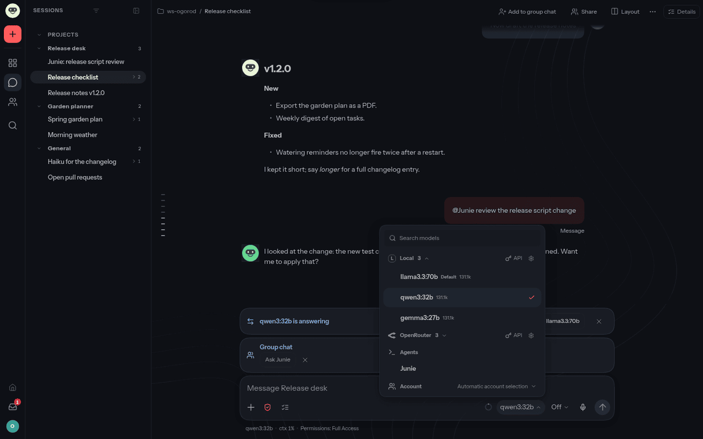
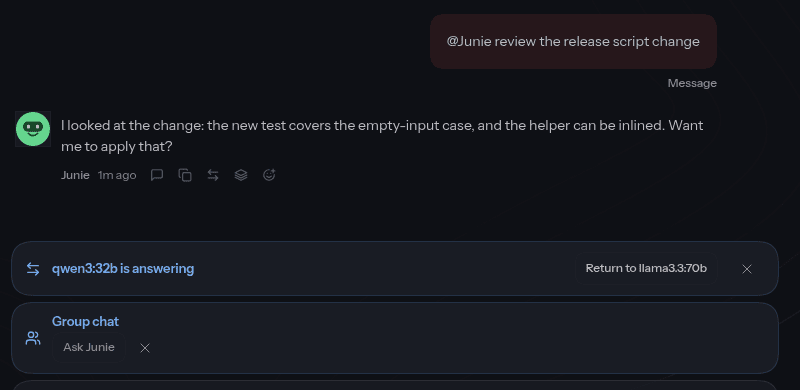
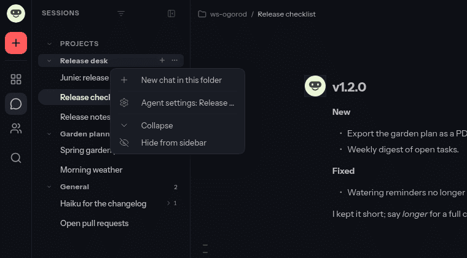
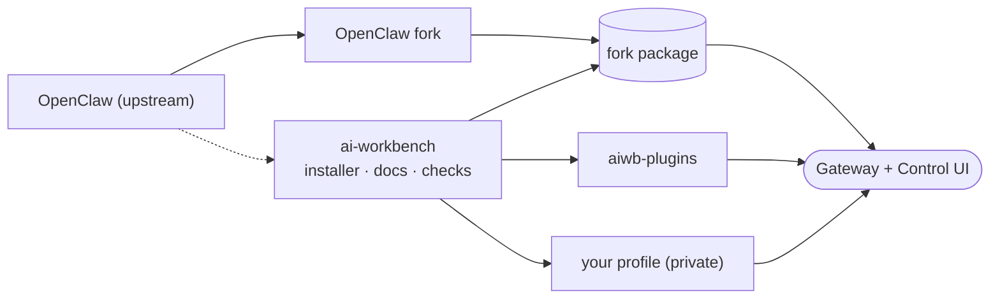

<h1 align="center">ai-workbench</h1>

<p align="center">
  <b>Claude Desktop's workflow — projects, memory, artifacts, scheduled tasks — on any model, on your own machine.</b><br>
  One installer turns <a href="https://github.com/openclaw/openclaw">OpenClaw</a> into a local AI workbench: free, local and paid
  models, Claude Code and other coding agents, in one chat.
</p>

<p align="center">
  <a href="https://github.com/SingularBunny/ai-workbench/actions/workflows/check.yml"></a>
  <a href="https://github.com/SingularBunny/ai-workbench/actions/workflows/docker.yml"></a>
  <a href="LICENSE"></a>
</p>

<p align="center">
  <a href="#quick-start">Quick start</a> ·
  <a href="#what-you-get">Features</a> ·
  <a href="#ai-workbench-vs-claude-desktop">Comparison</a> ·
  <a href="docs/index.md">Documentation</a> ·
  <a href="https://github.com/SingularBunny/aiwb-plugins">Plugins</a>
</p>

<p align="center">
  
</p>

## Why

- **Any model, not one vendor.** OpenRouter, Anthropic, [free providers](docs/install/free-providers.md) (Groq, Google AI
  Studio, …), Ollama on your machine or on a [remote VM](docs/install/remote-vm.md) — and your Claude subscription through
  Claude Code. Switch the model mid-chat with a button.
- **Coding agents in the same chat.** Hand a conversation to Claude Code or [JetBrains Junie](docs/integrations/junie.md)
  and back, or put several agents and models into one [group chat](docs/features/groups.md#group-chat-in-a-chat).
- **Your Claude Desktop setup comes along.** [Projects](docs/features/projects.md), [shared memory](docs/features/memory.md)
  and [chats](docs/features/chats.md) are imported; your plugins and skills install from their folders with their
  dependencies.
- **It keeps working without you.** [Scheduled tasks](docs/features/scheduled-tasks.md) with the same tools as Claude
  Desktop, [notifications](docs/features/notifications.md) when an agent finishes or asks.
- **Local and checked.** It runs on your machine, documents are converted locally, the installer shows its plan before
  it changes anything, and the install is checked daily in a clean Docker container
  (`--matrix` covers several Linux distributions).

## What you get

**fork** — needs the [ai-workbench OpenClaw fork](docs/fork-vs-upstream.md) (optional, recommended);
**Claude CLI** — Claude Code as the backend, for example on a Claude subscription.

<table>
<tr><td width="50%" valign="top">

**💬 Chats & models**
- Model picker with an **Agents** group, **Hand off to…** and **Return to …** · fork
- Every reply names its author — model or agent, with avatar · fork
- Refusal hint with a one-click hand-off to another model · fork
- [Multi-model](docs/features/multi-model.md): several models answer, a judge of another family picks or merges
- [Free model providers](docs/install/free-providers.md) set up from a key in `.env`
- Status line under the composer: model, context %, turn time, Claude limit · fork
- [Claude subscription limits](docs/features/claude-usage.md) in the sidebar · fork
- [Notifications](docs/features/notifications.md) when an agent finishes or asks

**🤖 Agents & group chats**
- [Group chat](docs/features/groups.md#group-chat-in-a-chat) in any chat: agents, ACP agents and models, `@name` or **Ask …** · fork
- [Groups](docs/features/groups.md) page: a manager picks who speaks next
- [JetBrains Junie](docs/integrations/junie.md) through ACP; OpenClaw as an agent in [JetBrains IDEs](docs/integrations/jetbrains.md)
- [Plan mode](docs/features/plan-mode.md) for any model; a **Plan** toggle in the composer · fork
- Claude Code permission modes, slash commands, background agents with **Stop**, todo list · fork · Claude CLI
- [Claude CLI on a remote VM](docs/install/remote-vm.md); a session continues after an ssh drop
- [Chrome extension](docs/integrations/chrome.md) finds the local OpenClaw

**🗂 Projects & memory**
- [Projects](docs/features/projects.md) and [chats](docs/features/chats.md) imported from Claude Desktop and Claude Code
- Projects tree with a folder menu: new chat here, open in file manager, copy path · fork
- Drag-and-drop order, move chats between folders, hide a folder · fork
- [Shared memory](docs/features/memory.md) for all agents, as in Claude Desktop
- [Knowledge base](docs/features/knowledge.md): note folders (an Obsidian vault works), PDF and Office searched, OCR for scans
- [Chat archive](docs/features/chat-archive.md) as Markdown, secrets scrubbed

</td><td width="50%" valign="top">

**📄 Files & documents**
- [Document preview](docs/features/document-preview.md): Word, Excel, PowerPoint, OpenDocument in the chat, converted locally · fork
- Office attachments reach any model as text · fork
- Files panel: Markdown rendered, **Download file**, **Open folder in file manager** · fork
- [Chat file folders](docs/features/chat-files.md): any file an agent attaches opens and downloads
- [Interactive widgets](docs/features/widgets.md), the counterpart of artifacts; state kept across reloads · fork
- Rewind restores the files an agent changed · fork

**⏰ Automations**
- [Scheduled tasks](docs/features/scheduled-tasks.md) with Claude Desktop's tools on top of OpenClaw automations
- **Runs** tab with an automation's history; silent runs keep the chat unread · fork
- Follow-up limit: a one-shot check can re-arm itself up to N times · fork

**🎙 Voice & hardware**
- [Dictation](docs/features/dictation.md) in the composer (Groq Whisper free tier, OpenAI, OpenRouter)
- [GPU use](docs/features/gpu.md): load, memory and the models holding it

**⚖️ Evaluation**
- [Judge](docs/features/judge.md): a model of another family scores answers against criteria
- [Skill evals on a non-Claude model](docs/features/evals.md) with the same runner

**🛠 Install & operations**
- One [installer](docs/install/index.md) for Linux, macOS, WSL and Windows; plan first, `--dry-run`
- [Personal profile](docs/index.md): your plugins, projects, tasks and settings in your own repository
- [System programs](docs/install/system-programs.md) listed with one install command
- [Maintenance mode](docs/install/run.md) during an install: chats pause, messages are resent · fork
- Graceful [restart and stop](docs/openclaw-fork.md#restarts-and-stops-wait-for-agent-turns): running turns are not cut off · fork
- Per-host [proxy routes](docs/install/network.md) · fork
- [Backup](docs/install/backup.md), [update and uninstall](docs/install/update-uninstall.md)

</td></tr>
</table>

<table>
<tr>
<td width="50%"></td>
<td width="50%"></td>
</tr>
<tr>
<td align="center">Group chat: an ACP agent answers under its own name</td>
<td align="center">Projects tree with the folder menu</td>
</tr>
</table>

## ai-workbench vs Claude Desktop

| | Claude Desktop | ai-workbench |
|---|---|---|
| Models | Claude | Any: OpenRouter, Anthropic, [free providers](docs/install/free-providers.md), Ollama, your Claude subscription via Claude Code |
| Local models | — | ✅ Ollama, also on a [remote VM](docs/install/remote-vm.md); [GPU panel](docs/features/gpu.md) |
| Switch model or agent mid-chat | Claude models | ✅ any model or agent, and back · fork |
| Several agents in one chat | — | ✅ [group chat](docs/features/groups.md) · fork |
| Projects, shared memory, artifacts | ✅ | ✅ [projects](docs/features/projects.md), [memory](docs/features/memory.md), [widgets](docs/features/widgets.md) — imported from Claude Desktop |
| Knowledge from your note folders | uploads to a project | ✅ [folders, Obsidian vaults](docs/features/knowledge.md), PDF/Office, OCR |
| Scheduled tasks | ✅ | ✅ [the same tools](docs/features/scheduled-tasks.md) |
| Answers checked by another model | — | ✅ [judge](docs/features/judge.md), [multi-model](docs/features/multi-model.md) |
| Plan mode | in Claude Code | ✅ [any model](docs/features/plan-mode.md) |
| Operating systems | macOS, Windows | Linux, macOS, WSL, Windows |
| Source | closed | MIT |

### Why the fork

ai-workbench works on the official OpenClaw; the [fork](docs/fork-vs-upstream.md) adds what a Claude Desktop user
misses in the Control UI:

- switch who answers by buttons, hand off and return, with the chat's context carried over;
- group chats with models and ACP agents as named participants;
- Claude Code in the browser: permission modes, slash commands, background agents, rewind with files;
- Office documents previewed in the chat; a Files panel with download and "open folder";
- a projects tree with a folder menu and drag-and-drop;
- graceful restarts and a maintenance mode, so an update does not cut running turns;
- release packages with signed build provenance (`gh attestation verify`).

The full grouped list, marked "any model" / "Claude CLI only", with the upstream backports:
[Why the OpenClaw fork](docs/fork-vs-upstream.md).

## Quick start

Linux, macOS or WSL; needs `git` and `curl` — no Node, no root.

```bash
git clone https://github.com/SingularBunny/ai-workbench.git && cd ai-workbench
installer/install.sh --dry-run          # what will be installed; changes nothing
installer/install.sh                    # shows the same plan and waits for y
$EDITOR ~/.openclaw/.env                # add a key, e.g. OPENROUTER_API_KEY=…
openclaw gateway run                    # then open http://127.0.0.1:18789 (new shell: ~/.openclaw/bin/openclaw)
```

Paste `OPENCLAW_GATEWAY_TOKEN` from `~/.openclaw/.env` into the **Gateway secret** field and write a message.
Step by step, with a Claude subscription instead of a key, and as a service:
[First run](docs/install/first-run.md) · [Keys](docs/install/keys.md) · [Running](docs/install/run.md).
Windows: `powershell -ExecutionPolicy Bypass -File installer\install.ps1`.

With the fork: put `WORKBENCH_OPENCLAW_PACKAGE` and `WORKBENCH_OPENCLAW_PACKAGE_SHA256` from the fork's
[releases page](https://github.com/SingularBunny/openclaw/releases) (take the release whose version matches `OPENCLAW_VERSION` in `openclaw/workbench.config.mjs`) into `~/.openclaw/.env` and re-run the installer —
[OpenClaw from a fork](docs/openclaw-fork.md).

## How it fits together



**ai-workbench** installs and checks; **[aiwb-plugins](https://github.com/SingularBunny/aiwb-plugins)** holds the plugins
(judge, Claude Desktop & Code bridge, shared memory, Office, Multi-model, Groups, plan mode, GPU, scheduled tasks);
the **[OpenClaw fork](https://github.com/SingularBunny/openclaw/releases)** is optional (without it the installer takes
the pinned official OpenClaw); **your profile** is your own repository with `profile.mjs`.
More: [How the repositories fit together](docs/repositories.md).

## Documentation

Everything is in [docs/](docs/index.md): installation, features, integrations, the fork, a
[settings reference](docs/reference/env.md). As a site: `pip install -r docs/requirements.txt && mkdocs serve`.

## Contributing

`tools/check.sh` is the pre-commit gate; the installer is validated in Docker (`tools/validate_in_docker.sh`), not on
your machine. Nothing personal goes into this repository. See [CONTRIBUTING.md](CONTRIBUTING.md) and the
[changelog](CHANGELOG.md).

## License

[MIT](LICENSE)
