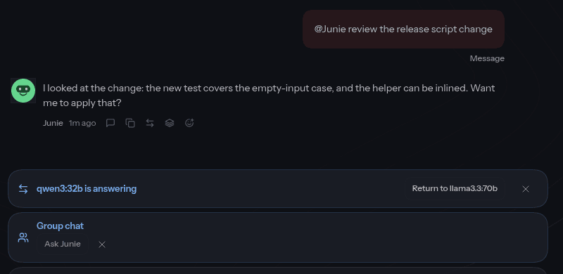

# Groups

Several agents in one conversation, as in a group chat: you write, and the agents answer in turn, each from its own
role. Two ways:

- **Group chat in a chat** (with the ai-workbench OpenClaw fork): add agents, ACP agents such as Junie, or models to
  any chat and ask them by name. See [below](#group-chat-in-a-chat).
- The **Groups** page of the Control UI (the `aiwb-groups` plugin, needs **Settings → Labs → Custom plugin UI**)
  lists groups of configured agents, creates and changes them, and shows the conversation; a manager picks who
  speaks next.

## How a round goes

After each of your messages:

1. Agents you mention (`@garden`, or by name) answer first, in the order you mention them.
2. Then the **manager** decides who speaks next: it reads the members (their names and descriptions) and the recent
   conversation and names the agent whose role fits what is still open, or hands back to you when the question is
   answered or an agent asked you something. It does not pick the agent that just spoke unless someone asked it.
3. At most **3 agent turns** follow one message (1–6, set per group), so a group does not talk on by itself.

This is the pattern of LobeHub's group chat and AutoGen's GroupChat (a manager choosing the next speaker). Groups
are for agents with different roles, instructions and tools working on one question; for the most reliable answer
to a single question, [Multi-model](multi-model.md) is the better tool.

## What each agent sees and does

Each agent answers with a **full turn of its own**: its model, instructions, memory and tools, in its own session
for this group (`agent:<id>:aiwb-group-<group>`), so its ordinary chats are not touched. The first time it gets who
is in the group; then each turn it gets what the user and the other agents said since its last reply, each line
marked with the speaker. The manager is an agent too (Main by default): it gets a short, tool-free question.

The reply is taken when the agent's turn ends (the `agent_end` hook), so the installer sets
`plugins.entries.aiwb-groups.hooks.allowConversationAccess`; without it the round waits and stops after 15 minutes.

## Groups

**New group**: pick 2–8 configured agents, the manager and the number of agent turns per message. **Change**
edits them; the conversation stays. **Stop** ends a round that is still running (the current agent's turn
finishes in its session). Groups are kept in `~/.openclaw/workbench/groups/`.

Cost: one manager question before each agent turn the manager picks, plus each agent's own turn on its own model.

## Group chat in a chat

In any chat of the Control UI (OpenClaw fork, `aiwb-groups` 0.2.0 or later):

- **Add to group chat**, in the chat header and as a switch at the top of the **Hand off…** menu, adds an OpenClaw
  agent, an ACP agent from `acp.allowedAgents` (for example Junie) or any model as a separate participant. The chat's
  own model or bound agent keeps answering; **Hand off** still switches that one answerer.
- The strip by the composer lists the members: **Ask <name>** puts `@<name>` in front of your message, the cross
  removes the member, **Stop** ends a turn that is still running.
- A message that names members (`@Junie review this`) goes to them one by one; any other message goes to the chat's
  own answerer as before. There is no manager here: you choose who answers next.
- Each member answers with a full turn of its own: an OpenClaw agent in its own session for this chat
  (`agent:<id>:aiwb-chat-<chat>`), a model as the chat's agent on that model, an ACP agent in its own persistent ACP
  session. It gets who is in the chat and what was said since its last turn, each line marked with the speaker.
- The reply is a row of the chat under the member's name and avatar: Retry under a failed turn, the refusal hint and
  the history work as for any reply, and the chat's own model reads it as shared history.

The reply is taken when the member's turn ends (the `agent_end` hook; the fork also fires it for ACP turns), so
`plugins.entries.aiwb-groups.hooks.allowConversationAccess` must be `true`. A model member is a model override,
allowed for the owner's Control UI (admin scope) or with `plugins.entries.aiwb-groups.subagent.allowModelOverride`.
Members are kept in `~/.openclaw/workbench/groups/chats/`.
