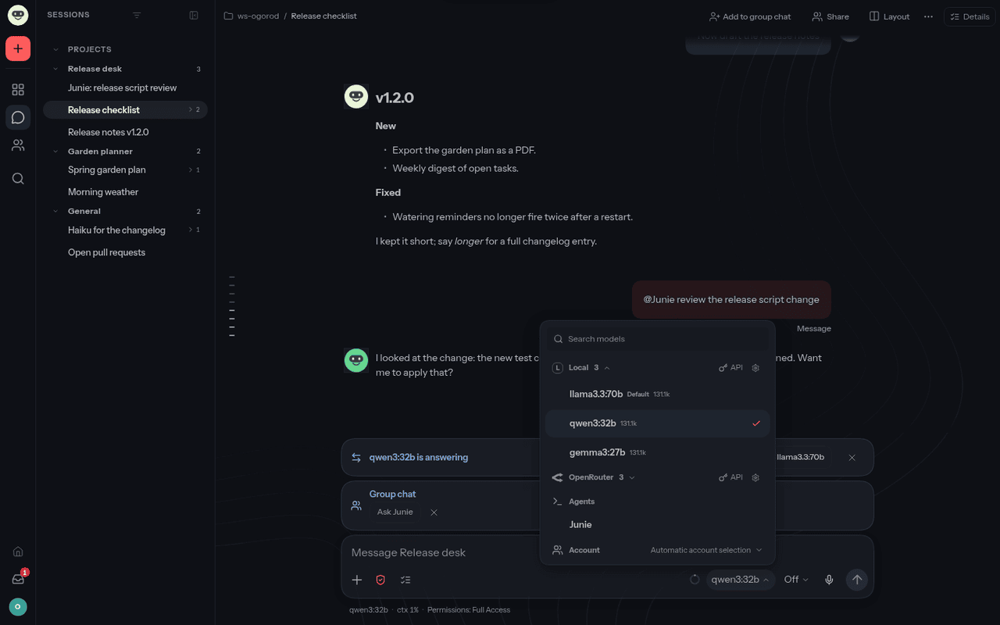
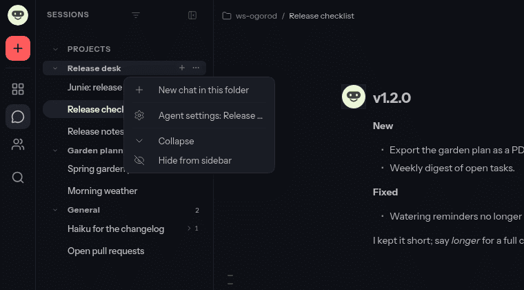
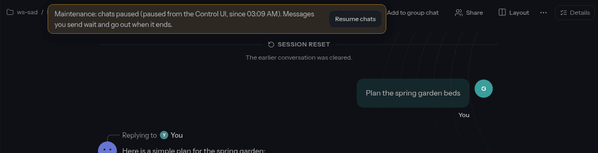

# Why the OpenClaw fork

ai-workbench runs on the official OpenClaw too. The
[OpenClaw fork](https://github.com/SingularBunny/openclaw/tree/aiwb/2026.11.5) (branch `aiwb/<version>`, based on an
OpenClaw release) adds what a Claude Desktop user misses in the Control UI. Without its settings it behaves as
upstream. How to install it: [OpenClaw from a fork](openclaw-fork.md). The full, exact list of changes is the
fork's [FORK.md](https://github.com/SingularBunny/openclaw/blob/aiwb/2026.11.5/FORK.md); this page groups it.

**Models**: *any model* — works whatever model the agent runs on; *Claude CLI* — needs the `claude-cli` backend
(Claude Code, for example on a Claude subscription).

## Who answers a chat

| Change | Models |
|---|---|
| Switch the answerer by buttons: an **Agents** group in the model picker, **Hand off to…** under a reply, a **… is answering · Return to …** chip, **Retry** / **Choose another model** under a failed turn | any model |
| Shared context across switches: an agent or model that takes over sees the chat's earlier messages, and replies say who wrote them | any model (Claude CLI part for resumed Claude sessions) |
| Each reply names its author: the model, or an ACP agent's own name and avatar | any model |
| [Group chat](features/groups.md#group-chat-in-a-chat) in any chat: add agents, ACP agents (such as [Junie](integrations/junie.md)) and models, ask them with `@name` or **Ask …** | any model |
| The model picker lists a bound ACP agent's own models | any model |
| Refusal hint: under a reply that looks like a refusal, "hand off to another model?" with a button; nothing switches by itself | any model |
| Chat commands as buttons: a **Plan** toggle for [plan mode](features/plan-mode.md), **New chat**, **Learn a skill from this chat**, **Reset chat…** | any model |
| A status line under the composer, as in Claude Code: model, context %, turn time, Claude 5 h limit, permission mode | any model |
| [Ask several models](features/multi-model.md#in-a-chat) from a message (plugin actions under a chat message) | any model |
| OpenRouter's daily free-model limit is named, with its reset time | any model |

## Claude Code in the chat

| Change | Models |
|---|---|
| Claude Code permission modes (`default`, `acceptEdits`, `plan`, `bypassPermissions`, …) picked in the composer | Claude CLI |
| Claude Code's own slash commands and skills in the composer `/` menu | Claude CLI |
| Prompt suggestions as composer ghost text | Claude CLI |
| Background agents and tasks in the working indicator, one row each, with **Stop** | Claude CLI |
| Claude's todo list in **Details → Task progress**, on any model Claude Code runs | Claude CLI |
| Rewind and **Fork from here** on every message, keeping Claude's native context; rewind can restore the files Claude changed | Claude CLI |
| Rewind restores files for chats on other models too, from OpenClaw's own checkpoints | any model |
| Image and PDF tools through a Claude subscription (no API key) | Claude CLI |
| Claude in Chrome for agent turns (`OPENCLAW_CLAUDE_CHROME=1`) | Claude CLI |
| A chat continued in a terminal (`claude --resume`) is picked up again, not overwritten | Claude CLI |
| [Claude subscription limits](features/claude-usage.md) at the bottom of the sidebar, and "limit reached" at once | any model; the Claude bars need a Claude login |
| Cleaner imported history (attachments shown once, tool results not "unknown", no repeated narration) and a watchdog that does not race Claude's own timeouts | Claude CLI |

## Projects tree and files

| Change | Models |
|---|---|
| Folder menu in the sidebar tree: **New chat in this folder**, **Open folder in file manager**, **Copy folder path**, **Agent settings** | any model |
| Drag-and-drop order of folders and chats, moving a chat to another folder, hiding a folder from the sidebar | any model |
| The tree keeps its rows and running/unread markers when another agent's chat opens or a refresh fails | any model |
| [Office documents](features/document-preview.md) open in the chat's PDF reader; Office attachments reach the model as text | any model |
| Files panel: Markdown as formatted text, **Download file**, **Open folder in file manager**, browsing the agent's working folder outside its workspace | any model |
| [Chat file folders](features/chat-files.md): files an assistant attaches from them open and download, whatever their type | any model |
| [Widgets](features/widgets.md) keep their state across reloads (`window.storage`, as in Claude artifacts) | any model |

## Automations

| Change | Models |
|---|---|
| An automation's chat has a **Runs** tab with its run history | any model |
| Follow-up limit: a one-shot continuation can re-arm itself up to N times (default 0 = upstream) | any model |
| Automation runs that end silently or fail keep the chat marked unread; automation chats in project folders follow **Show automation sessions** | any model |

## Running it every day

| Change | Models |
|---|---|
| [Graceful restart and stop](openclaw-fork.md#restarts-and-stops-wait-for-agent-turns): running agent turns are not cut off, the Control UI shows the wait | any model |
| Maintenance mode: chats pause during an [install](install/run.md), messages wait in the outbox and are resent | any model |
| Per-host [proxy routes](install/network.md) (`OPENCLAW_PROXY_ROUTES`), also for CLI agents | any model |
| Fork settings apply without a Gateway restart | any model |
| Utility-model pacing for running chats, one wake for several finished background commands | any model |
| Packages built on GitHub-hosted runners with signed build provenance (`gh attestation verify`) | — |

## Plugins and safety

| Change | Models |
|---|---|
| Same-named skills from different plugins stay available as `<plugin>:<name>` | any model |
| Marketplace plugins install the pinned commit (`sha`), not the branch head | any model |
| Image and PDF tools obey the model allowlist, so an agent cannot reach a paid model through them | any model |
| Plugins can add buttons under a chat message; ACP turns fire the `agent_end` hook; exact Gateway methods can be granted to a plugin | any model |
| The Sessions owner filter starts with **All owners**, so older chats are not hidden | any model |

## Upstream

Some changes are upstream OpenClaw's own fixes taken early, and some are fixes meant to go back upstream:

- **Backported from upstream**: a completed Claude CLI turn stores only its final message (#184098); plugin
  approvals on least-privilege runs (#171623, #186461); a gated tool returns its refusal guidance (#180637).
- **Backport candidates** (upstream bugs fixed here first): a CLI process that fails to spawn no longer blocks its
  chat forever; a finished turn of a chat bound to an ACP agent records its end, so the next send is not refused.
