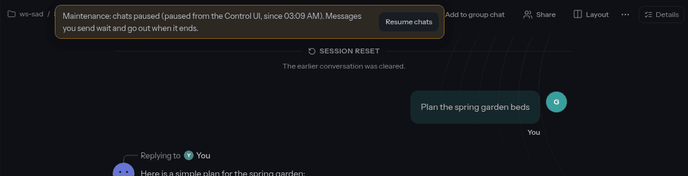

# Running

The OpenClaw installer puts `openclaw` in `~/.openclaw/bin` but does not add it to PATH.
Once, in `~/.bashrc` or `~/.zshrc`:

```bash
export PATH="$HOME/.openclaw/bin:$PATH"
```

```bash
openclaw gateway run          # Gateway on 127.0.0.1:18789
openclaw health               # is it alive
openclaw tui                  # terminal UI
```

To keep the Gateway running in the background and start it again after a reboot, install it as a service
(systemd user service on Linux, launchd on macOS; OpenClaw docs `cli/gateway.md`):

```bash
openclaw gateway install      # service openclaw-gateway, starts it now
systemctl --user restart openclaw-gateway    # restart (Linux)
journalctl --user -u openclaw-gateway -f     # its log (Linux)
```

On Linux the user service runs without an open session only with lingering on (`sudo loginctl enable-linger $(whoami)`, OpenClaw docs `gateway/index.md`).
When the installer replaces OpenClaw, the official `install-cli.sh` restarts the service by itself, and the
installer waits for it before writing settings. Before replacing OpenClaw the installer waits until no
Gateway session has a running agent turn (`sessions.list`, status `running`; queued turns do not count),
printing what it waits for every 5 minutes; Ctrl+C stops the install before anything is changed. With the
OpenClaw fork a restart or stop that comes anyway waits for running turns up to 30 minutes, and the
installer adds a systemd drop-in so that systemd does not kill the Gateway sooner
([OpenClaw fork](../openclaw-fork.md#restarts-and-stops-wait-for-agent-turns)). A few settings are read only when the Gateway starts (for
example `OPENCLAW_MEMORY_INDEX_ON_START`), so after an install that adds them, restart the service once more.
Do not also run `openclaw gateway run` while the service is active.

**Maintenance during an install.** With the OpenClaw fork (`gateway.maintenance.*`) the installer puts the
Gateway into maintenance mode before it replaces OpenClaw and keeps it there through the restart and the whole
setup; it turns it off when setup ends, also when setup fails or the install is stopped (Ctrl+C). Meanwhile no
chat turn starts:

- a message sent in the Control UI stays in its queue ("Chats are paused for maintenance…") and goes out by
  itself when maintenance ends; a channel with a durable queue keeps its messages and delivers them after;
  another channel answers "OpenClaw is under maintenance… send it again";
- scheduled automations that fall due wait and run right after (they are not skipped); heartbeats wait too;
- settings, plugins and skills are written as usual.

The Control UI shows "Maintenance: chats paused" with a **Resume chats** button. Turning it on, the installer
first waits for running agent turns, at most 30 minutes (`WORKBENCH_MAINTENANCE_WAIT_MIN`); if they still run,
it stops without changing anything and resumes chats. If the installer is killed outright, maintenance ends by
itself after 2 hours, or press **Resume chats**. An official OpenClaw without maintenance mode: the installer
waits for idle chats before the replacement as described above, and nothing pauses chats during setup.
Maintenance can also be turned on by hand: account menu (bottom left) → **Pause chats (maintenance)**.



Control UI — `http://127.0.0.1:18789`; the **Gateway secret** field takes `OPENCLAW_GATEWAY_TOKEN`
from `~/.openclaw/.env`.
