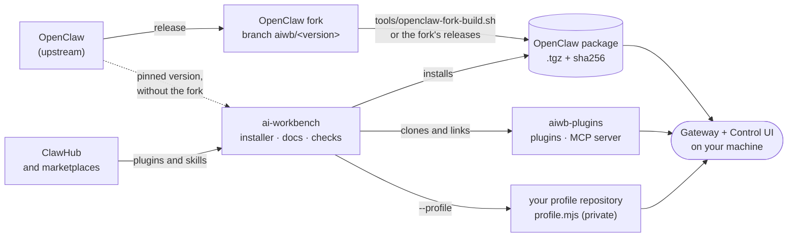

# How the repositories fit together

| Repository | What is in it | Who changes it |
|---|---|---|
| [ai-workbench](https://github.com/SingularBunny/ai-workbench) (this one) | The installer (`installer/`), migration from Claude Desktop (`migrate/`), these docs, the Docker checks (`tools/`) | public |
| [aiwb-plugins](https://github.com/SingularBunny/aiwb-plugins) | The ai-workbench plugins: judge, Claude Desktop & Code bridge, shared memory, Office, Multi-model, Groups, plan mode, GPU, fork settings, the scheduled-tasks MCP server | public; the installer clones it next to your own plugins |
| [OpenClaw fork](https://github.com/SingularBunny/openclaw/tree/aiwb/2026.11.3) | OpenClaw with the changes in its `FORK.md`, one branch per OpenClaw release (`aiwb/<version>`); packages on its releases page or built with `tools/openclaw-fork-build.sh` | public; optional — [why](fork-vs-upstream.md), [how](openclaw-fork.md) |
| Your profile | A folder or git repository with `profile.mjs`: your own plugins, skills, MCP servers, projects, scheduled tasks, settings | private, yours; `installer/install.sh --profile <folder or git URL>` |
| [OpenClaw](https://github.com/openclaw/openclaw) | The Gateway, Control UI, CLI; the installer pins a version in `openclaw/workbench.config.mjs` | upstream |
| [ClawHub](https://clawhub.ai) and the Anthropic marketplace | Plugins and skills to install; the Anthropic base plugins come from a pinned commit | upstream |

Secrets never go into any of them: they stay in `~/.openclaw/.env` on your machine.
